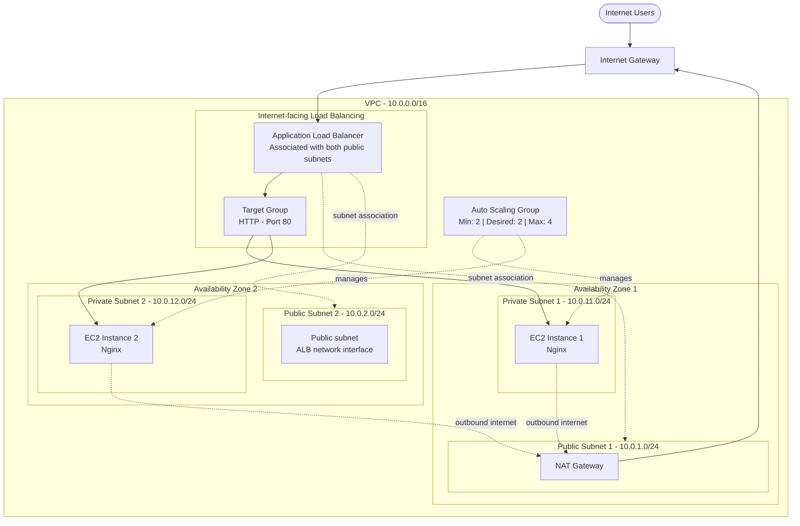

AWS Infrastructure Automation with Terraform

Project Overview

This project demonstrates the provisioning of a highly available AWS web infrastructure using Terraform (Infrastructure as Code).

The infrastructure hosts an Nginx web server on Amazon EC2 instances distributed across multiple Availability Zones. An Application Load Balancer distributes incoming HTTP traffic between the instances, while an Auto Scaling Group maintains the desired number of running instances.

All infrastructure resources are provisioned and managed through Terraform.

## Architecture

The infrastructure is deployed in AWS Stockholm (`eu-north-1`) across two Availability Zones.

### Architecture Notes

- The internet-facing ALB is deployed inside the VPC and associated with both public subnets.
- The Target Group registers EC2 instances running Nginx and performs health checks. The ALB distributes incoming requests to healthy targets.
- Both private subnets use a single NAT Gateway in AZ-1 for outbound internet connectivity. This is a cost-optimized design with a single point of failure for outbound connectivity.

  

Technologies Used

* AWS
* Terraform
* Amazon Linux 2023
* Nginx
* Linux / Bash
* AWS IAM
* Git & GitHub

AWS Infrastructure Components

AWS Service	Description
VPC	Custom isolated virtual network
Public Subnets	Host internet-facing infrastructure
Private Subnets	Host application servers
Internet Gateway	Provides internet connectivity to public resources
NAT Gateway	Allows outbound internet access from private subnets
Route Tables	Manage network traffic routing
Security Groups	Control inbound and outbound traffic
EC2	Hosts Nginx web servers
Launch Template	Defines EC2 instance configuration
Auto Scaling Group	Maintains and manages EC2 instances
Application Load Balancer	Distributes incoming HTTP traffic
Target Group	Registers instances and performs health checks

Network Configuration

* AWS Region: Europe (Stockholm) - eu-north-1
* VPC CIDR: 10.0.0.0/16

Public Subnets

Subnet	CIDR
Public Subnet 1	10.0.1.0/24
Public Subnet 2	10.0.2.0/24

Private Subnets

Subnet	CIDR
Private Subnet 1	10.0.11.0/24
Private Subnet 2	10.0.12.0/24

The infrastructure spans two Availability Zones to improve availability.

Auto Scaling Configuration

The Auto Scaling Group is configured with:

Parameter	Value
Minimum Capacity	2
Desired Capacity	2
Maximum Capacity	4
Instance Type	t3.micro
Operating System	Amazon Linux 2023

EC2 instances are automatically configured using a Launch Template and User Data.

The bootstrap script:

1. Updates the operating system.
2. Installs Nginx.
3. Enables the Nginx service.
4. Starts the web server.

Load Balancing

An internet-facing Application Load Balancer receives HTTP traffic on port 80.

The Target Group distributes traffic between EC2 instances and performs HTTP health checks on /.

The Auto Scaling Group automatically registers and deregisters instances with the Target Group.

Security

Security Groups implement basic network access control:

ALB Security Group

* HTTP (80): Allows public access.
* HTTPS (443): Rule configured, but HTTPS listener and certificate are not yet implemented.

EC2 Security Group

* HTTP (80): Allows traffic only from the ALB Security Group.
* No direct public HTTP access to EC2 instances.

AWS authentication is handled through an IAM Role attached to the Terraform controller EC2 instance, avoiding hardcoded AWS credentials.

Terraform Deployment

Prerequisites

* AWS account
* AWS CLI
* Terraform
* IAM Role with the required AWS permissions
* Git

1. Clone the repository

git clone YOUR_GITHUB_REPOSITORY_URL
cd aws-terraform-infrastructure

2. Initialize Terraform

terraform init

3. Validate configuration

terraform fmt
terraform validate

4. Preview infrastructure changes

terraform plan

5. Deploy infrastructure

terraform apply

Confirm the deployment by entering yes.

6. Access the application

After deployment, retrieve the Application Load Balancer DNS name:

terraform output alb_dns_name

Open the resulting address in your browser using HTTP.

The application displays a simple Nginx welcome page created through EC2 User Data.

Cleanup

To avoid unnecessary AWS charges, destroy the infrastructure when it is no longer needed:

terraform destroy

Confirm by entering yes.

Warning: This removes the Terraform-managed infrastructure, including the VPC, EC2 instances, NAT Gateway and Load Balancer.

Current Project Status

* VPC and networking
* Public and private subnets
* Internet Gateway
* NAT Gateway
* Route Tables
* Security Groups
* EC2 Launch Template
* Auto Scaling Group
* Application Load Balancer
* Target Group and health checks
* Nginx deployment using User Data
* Terraform remote state (S3)
* CloudWatch monitoring
* HTTPS configuration
* GitHub Actions CI/CD

Learning Objectives

Through this project, I gained practical experience with:

* Infrastructure as Code using Terraform.
* AWS networking and VPC architecture.
* Public and private subnet configuration.
* IAM Roles and AWS authentication.
* EC2 provisioning and automated configuration.
* Application Load Balancing.
* Auto Scaling and health checks.
* AWS infrastructure deployment and management.

Author

Developed as a hands-on DevOps and AWS Cloud Engineering portfolio project.
